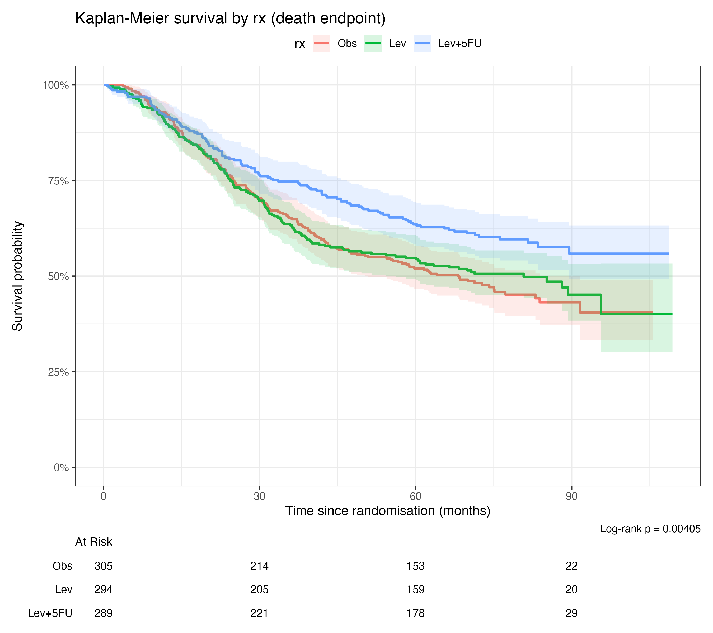
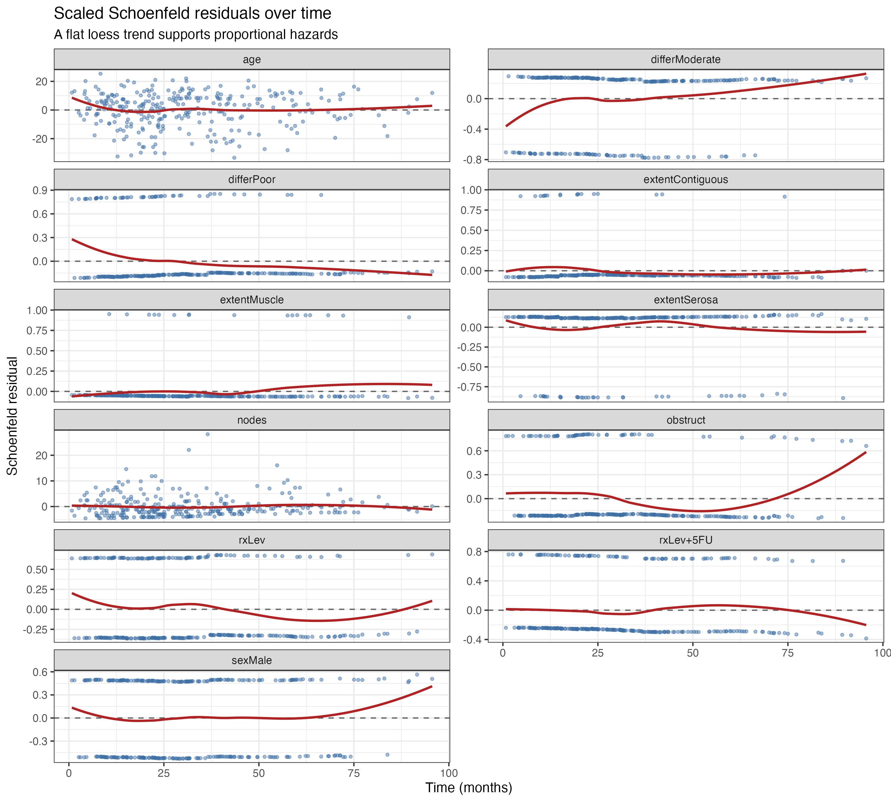
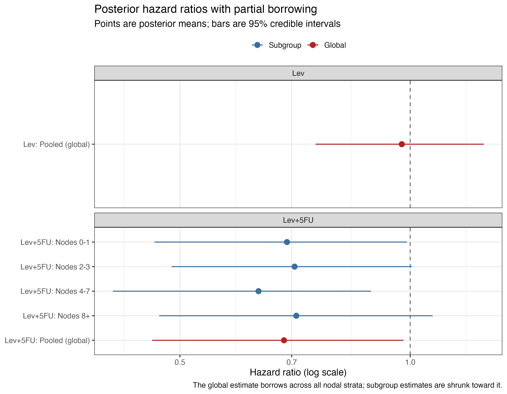
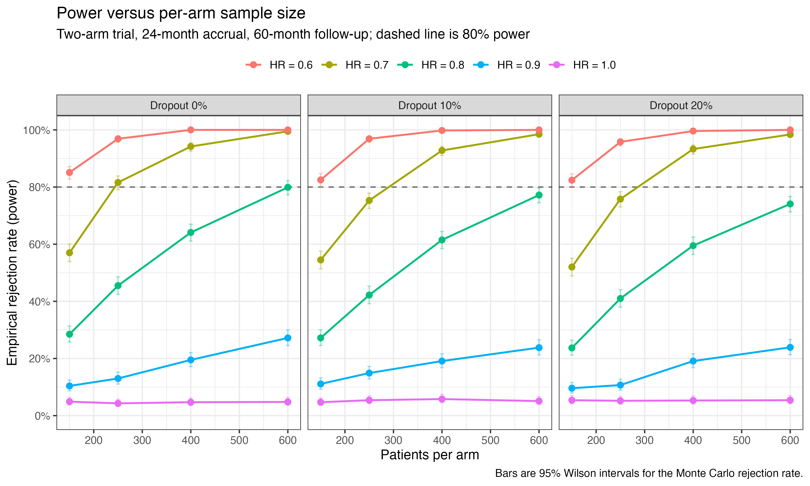

# trialsurv

`trialsurv` is an installable R package for Bayesian and frequentist
time-to-event analysis of clinical trial data. It takes the `survival::colon`
adjuvant chemotherapy data from raw rows to a rendered, artifact-only
GO/NO-GO report. Every number in the report and in this README is read from a
file under `results/`; the report never refits a model.

Version 0.1.0 requires R >= 4.2 and is licensed under MIT.

## What the package does

- Loads the two-endpoint colon cancer trial data into a tidy patient-by-endpoint
  tibble, with explicit complete-case handling and cohort/missingness metadata.
- Fits Kaplan-Meier curves with risk tables, median survival, landmark survival
  and the log-rank test.
- Fits unadjusted and covariate-adjusted Cox proportional hazards models,
  checks proportional hazards with Schoenfeld residuals, counts deviance
  outliers and evaluates held-out Harrell concordance.
- Fits a hierarchical Bayesian Weibull survival model in which the primary
  experimental treatment effect is partially pooled across four nodal-risk
  strata, then quantifies the borrowing, compares it with the frequentist
  analysis and computes posterior held-out concordance.
- Simulates two-arm trials with staggered accrual, administrative censoring and
  dropout; estimates power and type I error over a design grid; and searches
  for the per-arm sample size needed for a target power, comparing it with the
  Schoenfeld analytic calculation.
- Renders a self-contained Quarto report written for a non-statistician
  clinical reviewer, ending in an explicit GO / NO-GO / GO-WITH-MODIFICATION
  recommendation.

## Repository architecture

```
TrialSurv/
├── DESCRIPTION, NAMESPACE, LICENSE, NEWS.md
├── R/
│   ├── data.R          load_trial_data() — tidy two-endpoint colon data
│   ├── split.R         trial_split() — reproducible stratified patient split
│   ├── km.R            km_fit() — Kaplan-Meier, landmark survival, log-rank
│   ├── cox.R           cox_fit(), cox_diagnostics(), concordance_eval()
│   ├── plots.R         plot_km(), plot_schoenfeld()
│   ├── bayes.R         bayes_surv_fit(), bayes_summary(),
│   │                   shrinkage_report(), bayes_concordance()
│   ├── bayes_plots.R   plot_posterior_hr(), plot_trace()
│   ├── compare.R       compare_models() — frequentist vs Bayesian
│   ├── simulate.R      simulate_trial(), trial_power(), required_n()
│   ├── report.R        render_report() — Quarto wrapper and input check
│   └── utils.R         internal validation, result-writing and figure helpers
├── scripts/
│   ├── 01_frequentist.R   KM, Cox, PH diagnostics, held-out C-index
│   ├── 02_bayesian.R      hierarchical model, shrinkage, comparison
│   ├── 03_simulation.R    power grid, type I error, sample-size search
│   ├── coverage.R         test summary and measured covr coverage
│   └── run_all.R          01 → 02 → 03 → report, plus session_info.txt
├── tests/testthat/        8 test files, 35 test blocks, 180 expectations
├── results/               committed CSV/JSON analysis artifacts
├── figures/               committed KM, Schoenfeld, forest, trace, power plots
├── report/
│   ├── trial_report.qmd   artifact-only report source
│   └── trial_report.html  rendered self-contained report
└── .github/workflows/
    ├── R-CMD-check.yaml   check on ubuntu-latest, lintr/styler, covr print
    └── report.yaml        workflow_dispatch render of the Quarto report
```

### Data flow

1. `survival::colon` stores two rows per patient: recurrence and death.
   `load_trial_data()` reshapes it to one row per patient per endpoint, converts
   days to months, labels the arms, and drops incomplete baseline records.
2. `trial_split()` splits patients, not rows, stratified by arm and death
   status. The same 70/30 split feeds both the frequentist and Bayesian
   analyses.
3. `km_fit()` and `plot_km()` describe survival by arm; `cox_fit()`,
   `cox_diagnostics()`, `concordance_eval()` and `plot_schoenfeld()` produce the
   adjusted treatment effect, PH diagnostics and held-out discrimination.
4. `bayes_surv_fit()` fits the hierarchical Weibull model on the training split;
   `bayes_summary()`, `shrinkage_report()` and `bayes_concordance()` write the
   posterior, shrinkage and posterior-C-index artifacts.
5. `compare_models()` puts the frequentist and Bayesian treatment effects,
   interval widths, C-indices and WAIC side by side.
6. `simulate_trial()`, `trial_power()` and `required_n()` produce the power
   curve, the empirical type I error check and the sample-size comparison.
7. `render_report()` reads only `results/` and `figures/` and renders the
   GO/NO-GO HTML.
8. `run_all.R` executes stages 1–3 and the report in order and records stage
   runtimes and `sessionInfo()` in `results/session_info.txt`.

## How to run

### Dependencies

```r
install.packages(c(
  "survival", "dplyr", "tidyr", "ggplot2", "purrr", "tibble", "rlang",
  "jsonlite", "posterior", "testthat", "roxygen2", "devtools",
  "ggsurvfit", "brms", "rstan", "quarto", "knitr", "rmarkdown",
  "covr", "lintr", "styler"
))
```

`brms` and `rstan` need a working C++ toolchain. The build recorded here used
rstan 2.32.7 on macOS arm64. If Stan cannot be installed, the package still
provides a self-contained `backend = "mcmc"` sampler; the reported headline
results use the brms/rstan backend.

### Install and run

```r
devtools::install()          # or: R CMD INSTALL .
```

```bash
Rscript scripts/run_all.R    # full pipeline, including the rendered report
Rscript -e 'devtools::test()'
Rscript -e 'devtools::check()'
Rscript scripts/coverage.R   # writes results/coverage.txt and test_summary.csv
Rscript -e 'trialsurv::render_report()'
```

`run_all.R` can regenerate the pipeline from an empty `results/`. Measured
runtime on R 4.6.1, macOS arm64, 8 logical cores:

| Stage | Command | Measured time |
|---|---|---:|
| Frequentist | `Rscript scripts/01_frequentist.R` | 3.2 s |
| Bayesian | `Rscript scripts/02_bayesian.R` | 260.6 s |
| Simulation | `Rscript scripts/03_simulation.R` | 141.5 s |
| Report | `Rscript -e 'trialsurv::render_report()'` | 7.8 s |
| **Total** | `Rscript scripts/run_all.R` | **413.1 s (6.9 min)** |

The Bayesian stage includes Stan compilation and four chains; the first run is
the slowest. The simulation stage ran 96,000 trials in 139.3 s on 7 cores
(141.5 s for the whole stage).

## Results

All figures below were produced by `Rscript scripts/run_all.R` and read back
from `results/` and `figures/` during this build.

### Cohort

The death-endpoint analysis contains **888 patients**, **430 deaths** and a
median follow-up of **77.3 months** (reverse Kaplan-Meier). The recurrence
endpoint contains 446 events and 75.7 months of median follow-up. The analysis
is complete-case: patients with a missing required baseline variable were
excluded before modelling.

### Survival by arm

| Arm | n | Deaths | Median survival (months) | 5-year survival |
|---|---:|---:|---|---|
| Observation | 305 | 164 | 68.2 (95% CI 50.3–83.8) | 52.0% (46.7–57.9) |
| Levamisole | 294 | 149 | 80.8 (95% CI 56.1–not reached) | 54.8% (49.3–60.8) |
| Lev+5FU | 289 | 117 | Not reached (lower limit 89.5) | 63.6% (58.3–69.4) |

The log-rank test gave chi-square = **11.02** on 2 degrees of freedom,
**p = 0.00405**. The 5-year absolute survival gain for Lev+5FU versus
observation was **11.6 percentage points**.



### Treatment effect

| Model | Contrast | HR (95% CI) | p |
|---|---|---|---:|
| Unadjusted Cox | Lev+5FU vs Obs | 0.671 (0.505–0.892) | 0.00610 |
| Adjusted Cox | Lev+5FU vs Obs | **0.643 (0.482–0.857)** | **0.00261** |
| Adjusted Cox | Lev vs Obs | 0.913 (0.696–1.197) | 0.511 |

The adjusted model includes age, sex, number of positive nodes, extent of
disease, differentiation and obstruction. At any given time after surgery, the
Lev+5FU arm had about **36% lower instantaneous risk of death** than
observation, and the confidence interval excludes no effect.

### Proportional hazards diagnostics

- Global `cox.zph`: chi-square = **29.69**, 11 df, **p = 0.00177**.
- The Lev+5FU treatment term did **not** violate PH: chi-square = 0.150,
  p = 0.698.
- Terms flagged at alpha = 0.05: `rxLev`, `extentMuscle`,
  `extentContiguous`, `differModerate`, `differPoor`, `obstruct`.
- Deviance-residual outliers (|r| > 3): 2 of 618 training observations (0.3%).

The global test says the full Cox model is an imperfect description of the
data, so the HR is a useful but not complete summary. The treatment-specific
test is reassuring; it does not prove a constant treatment effect.



### Held-out discrimination

On the 30% test set (270 patients, 131 deaths), Harrell's C-index was **0.648
(95% CI 0.602–0.694)** for the adjusted Cox model and 0.532 (0.483–0.582) for
the unadjusted model. The model discriminates moderately well; it is not a
prediction tool.

### Bayesian hierarchical model

The primary analysis is a Weibull proportional hazards model fitted with
**brms 2.23.0 + rstan 2.32.7** (4 chains × 4,000 iterations). The Lev+5FU
effect has a hierarchical random effect across four nodal-risk strata
(0–1, 2–3, 4–7, 8+ positive nodes), with a half-normal(0, 0.5) prior on the
random-effect standard deviation. The model adjusts for age, sex, extent,
differentiation and obstruction.

| Parameter | Posterior mean HR | 95% credible interval | R-hat | Bulk ESS |
|---|---:|---|---:|---:|
| Lev+5FU global | **0.684** | **0.460–0.980** | 1.0003 | 5,796 |
| Nodes 0–1 | 0.690 | 0.463–0.990 | 0.9999 | 9,073 |
| Nodes 2–3 | 0.706 | 0.488–1.005 | 1.0000 | 8,401 |
| Nodes 4–7 | 0.633 | 0.409–0.889 | 0.9999 | 8,181 |
| Nodes 8+ | 0.710 | 0.470–1.070 | 1.0000 | 9,460 |

The fit converged with **maximum R-hat 1.0010**, **minimum bulk ESS 3,310.5**,
**minimum tail ESS 3,533.0** and **zero divergent transitions**. The global
Lev effect was 0.975 (0.752–1.248).



**Borrowing and shrinkage.** The partially pooled estimates are pulled toward
the global effect, and every stratum's interval is narrower than its standalone
Cox interval:

| Stratum | n | Deaths | Standalone HR | Pooled HR | Absolute movement (log-HR) | Interval width reduction |
|---|---:|---:|---:|---:|---:|---:|
| Nodes 0–1 | 187 | 64 | 0.683 | 0.678 | 0.008 | 35.8% |
| Nodes 2–3 | 216 | 92 | 0.675 | 0.695 | 0.029 | 30.2% |
| Nodes 4–7 | 141 | 87 | 0.616 | 0.622 | 0.009 | 30.2% |
| Nodes 8+ | 74 | 56 | 0.825 | 0.695 | 0.171 | 36.5% |

The 8+ node stratum, the smallest subgroup (74 patients), moved the most
(0.171 on the log-HR scale) and still narrowed by 36.5%. In the 2–3 node
stratum the standalone estimate was already essentially the global effect, so
the *percentage* movement is unstable and negative; the absolute movement is
only 0.029 and the interval narrowed by 30.2%.

### Frequentist versus Bayesian

| Model | HR (95% interval) | Interval width | Held-out C-index | WAIC |
|---|---|---:|---:|---:|
| Frequentist (adjusted Cox) | 0.643 (0.482–0.857) | 0.375 | 0.648 (0.602–0.694) | — |
| Bayesian (hierarchical Weibull) | 0.684 (0.460–0.980) | 0.520 | 0.652 (0.629–0.669) | 3372.7 |

The two approaches agree on direction and approximate size. The Bayesian
interval is wider because it carries the hierarchical uncertainty about
between-stratum differences. Held-out discrimination is essentially identical.

### Design simulation

The pooled empirical type I error at HR = 1 was **0.05083 (95% Monte Carlo
interval 0.04690–0.05476)** over **12,000** null simulations, consistent with
the nominal 5%. All 12 null design cells were within two Monte Carlo standard
errors of 0.05.

| Target HR | Dropout | Simulated n per arm | Power | Schoenfeld n | Simulated / Schoenfeld |
|---:|---:|---:|---:|---:|---:|
| 0.8 | 0% | 800 | 0.897 | 602 | 1.33 |
| 0.7 | 0% | 300 | 0.885 | 246 | 1.22 |
| 0.8 | 20% | 800 | 0.858 | 675 | 1.19 |
| 0.7 | 20% | 300 | 0.824 | 276 | 1.09 |

For 80% power at **HR = 0.7 with 20% dropout**, the simulation required
**300 patients per arm** (observed power 0.824), versus the Schoenfeld
calculation's **276 per arm**. At **HR = 0.8 with 20% dropout**, the
corresponding sizes were **800** and **675** per arm. The simulation ran
**96,000** trials in **139.3 s** on 7 cores.



### Tests and coverage

The coverage run recorded **8 test files**, **35 test blocks** and **180
expectations**, with **0 failures and 0 skipped** (the optional Stan smoke test
was enabled with `TRIALSURV_TEST_BRMS=true`). Measured package coverage is
**88.69%** (`results/coverage.txt`), above the 85% target. Per-file coverage
ranges from 83.6% (`R/plots.R`) to 98.0% (`R/split.R`).

`devtools::check()` reports **0 errors, 0 warnings and 0 notes**. The CI
workflow runs `R CMD check` on ubuntu-latest, a lintr/styler job, and a covr
coverage print; the report workflow renders the Quarto HTML as a
`workflow_dispatch` artifact. The Stan smoke test is opt-in locally and skipped
on CI; the full brms fit in `scripts/02_bayesian.R` is the primary proof of the
Stan backend.

### GO/NO-GO conclusion

The report reached **GO-WITH-MODIFICATION**.

The three numbers driving it:

1. Adjusted HR **0.643 (95% CI 0.482–0.857)**, with Bayesian global HR 0.684
   (95% CrI 0.460–0.980).
2. 5-year survival **63.6% vs 52.0%**, an **11.6 percentage-point** absolute
   gain (log-rank p = 0.00405).
3. About **300 patients per arm** for 80% power at HR = 0.7 with 20% dropout
   (Schoenfeld 276).

The three main caveats:

1. Proportional hazards is not globally satisfied (p = 0.00177; violations in
   `rxLev`, `extentMuscle`, `extentContiguous`, `differModerate`,
   `differPoor`, `obstruct`). The treatment-specific test is not significant,
   but the next trial should pre-specify a time-varying or restricted-mean
   survival sensitivity analysis.
2. The Bayesian subgroup intervals remain wide, especially in the 8+ node
   stratum (74 patients), and borrowing is deliberately modest. Subgroup
   estimates should guide stratification, not support definitive subgroup
   claims.
3. The design simulation assumes exponential survival, proportional hazards,
   non-informative dropout and no competing risks, and the evidence comes from
   one historical trial. The next trial should use the simulation-based sample
   size and a pre-specified analysis plan.

The full rendered argument, including the plain-language explanations for a
non-statistician reviewer, is in `report/trial_report.html`.

## Limitations and assumptions

- **Proportional hazards is imperfect.** The treatment-specific Schoenfeld test
  is not significant, but the global test and several covariates are. The HR is
  a time-averaged summary, not a complete description of the survival curves.
- **The Bayesian hierarchy pools the primary arm only.** Lev+5FU subgroup
  effects are partially pooled across nodal strata; levamisole is a fixed
  effect. This keeps the borrowing structure identifiable and interpretable.
  `pool = "all"` is available for a more weakly identified sensitivity fit.
- **Subgroups are small.** The 8+ node stratum has 74 patients and 56 deaths;
  its interval is the widest even after borrowing. Four strata is enough to
  demonstrate borrowing, not enough for precise subgroup claims.
- **Complete-case analysis.** Patients missing a required baseline variable
  were excluded; no imputation is performed.
- **Simulation assumptions.** Exponential control survival, proportional
  hazards, non-informative dropout and no competing risks. The Schoenfeld
  comparison is an analytic reality check, not a replacement for the
  simulation.
- **Single historical trial.** The colon data are a well-known adjuvant trial,
  but external validation in a contemporary population is still needed.

## Bayesian backend

The reported Bayesian results use **brms 2.23.0 with rstan 2.32.7**. A
self-contained Metropolis-within-Gibbs Weibull sampler is also implemented
(`bayes_surv_fit(..., backend = "mcmc")`) and tested for environments where
Stan cannot be installed; it was not used for the headline numbers. The primary
fit converged with maximum R-hat 1.0010 and zero divergent transitions.

## License

MIT © 2026 TrialSurv Authors.
